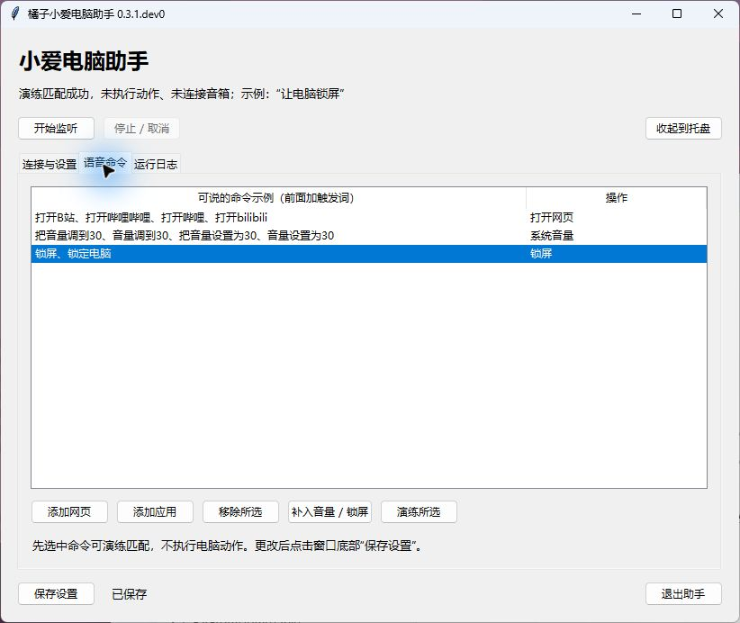

# 橘子小爱电脑助手

**用小爱音箱的固定口令，打开 Windows 上的网页和应用、调音量、锁屏。**

想离开键鼠时也能操作电脑？对音箱说一句：

> 小爱同学，让电脑打开 B 站。

适合已有小爱音箱和 Windows 电脑、愿意参与早期测试的用户。简单命令由本地规则执行，无需大模型或自建服务器。

**[下载与版本](#下载与版本)** · [快速开始](#快速开始) · [使用与排错](docs/QUICKSTART.md) · [反馈问题](https://github.com/Manamiiii/TangerineXiaoAiAssistant/issues/new?template=bug_report.md)

> **测试阶段：真实音箱的登录、语音读取和播报尚未完成验收，目前没有已验证机型清单。** Windows 本地程序已有测试；请先用现有设备验证，不要为此专门购买音箱。

## 可以做什么

| 对音箱说 | 电脑执行 |
|---|---|
| 让电脑打开 B 站 | 用默认浏览器打开配置好的固定网址 |
| 让电脑打开微信 | 启动事先登记的微信 EXE，需要先安装并添加应用 |
| 让电脑把音量调到三十 | 将默认播放设备音量设为 30%，保留原静音状态 |
| 让电脑锁屏 | 向 Windows 发出锁屏请求 |

支持添加网页、应用和语音别名；只匹配配置中的口令，语音不能直接运行任意 Shell 命令。程序可收起到托盘，开机自启默认关闭，由你选择开启。

查看真实界面预览（0.3.1.dev0 开发版，尚无 Release 包）

这是开发版的**本地规则演练**，不是音箱联动演示。公开的 0.3.0 尚无“演练所选”按钮，保存按钮也位于“连接与设置”页。

## 下载与版本

**本轮 Windows 安装版是 0.4.2 Setup，目前只有本地验收候选包，尚未在 GitHub 提供下载。请等待验收后发布，不要把 Releases 中的 0.3.0 ZIP 当成安装版。**

| 版本 | 状态 | 获取方式 |
|---|---|---|
| **0.4.2** | Windows x64 Setup / Portable，本地候选、待验收 | 暂无公开安装包；main 提供[安装与构建说明](docs/INSTALLER.md) |
| **0.3.0** | 历史 Windows x64 便携测试版，没有安装向导 | [历史 Release](https://github.com/Manamiiii/TangerineXiaoAiAssistant/releases/tag/v0.3.0)，不是本轮候选包 |

**旧包 0.3.0 尚未包含开发版的图像依赖安全更新和配置保存防护，建议等待修复版后再尝试。** [查看更新背景与安全边界](docs/PRIVACY.md#分发与依赖)。

0.3.0 还缺少项目自身的 GPL 许可文件；包内第三方许可和源码材料的实际核对结果、拟补充方案见[发布材料核对](docs/RELEASE_REVIEW.md)。更新 main 不会改变已经下载的旧包。

- GitHub 代码目录没有 `dist`；`Code → Download ZIP` 和 `Source code` 都是源码，不是运行包。
- 0.4.2 候选文件名为 `TangerineXiaoAiAssistant-0.4.2-windows-x64-Setup.exe`；独立 Portable 为同版本 `.zip`。运行均不需要 Python。
- 候选包未签名，附有 `SHA256SUMS.txt`；不要关闭 Windows 防护或忽略检测结果。

仅供核对历史版本：0.3.0 下载位置

在历史 Release 的 **Assets** 中，`TangerineXiaoAiAssistant-0.3.0-windows-x64.zip` 是解压即运行的旧便携测试包（约 40 MB）。[原 ZIP 下载链接](https://github.com/Manamiiii/TangerineXiaoAiAssistant/releases/download/v0.3.0/TangerineXiaoAiAssistant-0.3.0-windows-x64.zip)及旧校验文件未在本轮替换。

## 快速开始

已获得 0.4.2 本地候选包的测试者：运行 Setup，从开始菜单或桌面“安装版”快捷方式启动。新装程序位于 `%LOCALAPPDATA%\Tangerine\Apps\TangerineXiaoAiAssistant`，已有两种旧安装目录原位升级。升级/卸载默认保留本机数据，详见 [安装版说明](docs/INSTALLER.md)。使用 Portable 时先完整解压，再双击 `TangerineXiaoAiAssistant-Desktop.exe`；不要在压缩包中运行。不带 `-Desktop` 的 EXE 是命令行工具。

准备好 **Windows 10/11 x64 电脑、小爱音箱、绑定音箱的小米账号和米家 App**。电脑与音箱需要联网；电脑需已开机、登录桌面并保持助手运行。不需要管理员权限。目前只在 Windows 11 上验证过本地程序。

真实音箱最小验收（**未验证**，需要你现有的设备与小米账号）：

1. **扫码**：点击“扫码登录小米”，用米家 App 扫码，在手机确认。不要分享二维码或登录凭据。
2. **选音箱**：选择要控制的音箱并保存设置；确认保留了默认“打开 B 站”网页白名单规则。
3. **开始监听**：等界面显示正在监听。如果登录、设备列表或监听失败，记录当前步骤和固定错误提示，先停止本次测试。
4. **只说一次**：“小爱同学，让电脑打开 B 站”。预期默认浏览器打开配置的网址一次；再等 10 秒，期间不重复说口令，确认没有重复打开，然后停止监听。

通过仅代表这台设备的一次链路验收；不代表 TTS、休眠恢复或长期稳定性已验证。无需用锁屏、音量或自启功能验收。“检查连接”可辅助排错；返回记录数量不证明后续语音一定能收到。

“停止 / 取消”可停止监听。**关闭窗口会收起到托盘，完全退出请用“退出助手”或托盘右键“退出”。**

第一次尝试遇到问题，按 [现象与处理方法](docs/QUICKSTART.md#根据现象排错) 排查。添加应用、升级、配置恢复和卸载也在同一份说明中。

## 使用边界与隐私

- **需要小米云端服务**：语音识别由音箱和小米服务完成，助手读取对话记录后在本地匹配规则；同一局域网不意味着离线可用。
- **固定口令，不是自由对话**：应用需先登记，不支持随口提供网址或复杂任务。WorkBuddy 真实任务尚未接入；不能唤醒关机或休眠电脑。
- **设备兼容性待验证**：没有全型号、海外地区或共享设备兼容保证；长时间运行、休眠恢复、Windows 10 和真实开机自启仍待验证。
- **口令不验证说话人**：音箱附近其他人也可能触发已配置操作，不需要的规则可以移除。
- **凭据在本机加密保存**：默认数据目录是 `%LOCALAPPDATA%\Tangerine\Data\TangerineXiaoAiAssistant`，按配置、凭据、日志和备份分类，旧数据迁移保留原件。[目录与恢复](docs/STORAGE.md)。不加入遥测，不开放远程控制端口；日志不记录语音全文或 Token。[隐私与安全说明](docs/PRIVACY.md)

## 帮助与反馈

[首次使用与排错](docs/QUICKSTART.md) · [配置示例](config.example.json) · [实际验证记录](docs/VALIDATION.md)

反馈问题时请提供**程序版本、Windows 版本、音箱型号、失败步骤和界面固定提示**，并说明“检查连接”是否通过。不要发送二维码、密码、Token 或整个数据目录。[提交使用问题](https://github.com/Manamiiii/TangerineXiaoAiAssistant/issues/new?template=bug_report.md)

## 开发与致谢

| 从哪里找 | 用途 |
|---|---|
| `src/xiaoai_pc/` | 应用源码。`cli.py` 分发命令，`desktop.py` 管理窗口、托盘及监听任务，`startup.py` 生成用户自启命令。 |
| `src/xiaoai_pc/storage.py` | 默认数据布局、旧版兼容锁及保留原件的迁移。详见 [目录与恢复](docs/STORAGE.md)。 |
| `src/xiaoai_pc/icon.py` | 原创图标绘制源。窗口、托盘和构建脚本共用，构建时生成多尺寸 `app.ico` 并嵌入程序与安装器。 |
| `docs/`、`docs/images/` | 使用、维护、验证说明和界面示例图。 |
| `scripts/`、`installer/windows/` | EXE 入口、打包与校验脚本，Windows 安装模板和编译器版本。`scripts/source-files.txt` 是随包源码清单。 |
| `tests/`、`.github/workflows/` | 源码回归、Windows 成品与隔离安装验证。 |
| `dist/`、`build/` | 本地忽略目录。`dist/` 存正式身份候选与校验文件，`build/` 存带独立身份的安装测试包、临时编译文件、构建日志与测试结果。运行日志另存于本用户的数据目录。 |

桌面 EXE 无参数时打开窗口，CLI 和 `python -m xiaoai_pc` 接收原有子命令。`--data-dir`、`--config` 是子命令前的全局参数。自启使用原有 `desktop --hidden` 并保留自定义数据和配置参数；数据身份、监听任务及单实例锁随同一个助手运行。默认目录取自 `LOCALAPPDATA`，相对参数按调用方工作目录解析，本程序不监听本地服务端口。

便携包中的 `login.cmd`、`probe.cmd`、`run.cmd`、`configure-app.cmd` 和 `upgrade-config.cmd` 仍按脚本自身目录定位 EXE，先初始化，再分别登录、检查连接、监听、登记应用和补入命令。构建和普通启动均不会生成桌面快捷方式。Setup 默认只建立开始菜单入口，桌面快捷方式需主动勾选，因此再次安装不会自动补回已整理的桌面入口。

项目名为 `TangerineXiaoAiAssistant`，使用 Python，窄范围复用 [VoxNode](https://github.com/Almmor/VoxNode) 的小米通信代码，保留上游许可与修改记录。

[源码运行与构建](docs/DEVELOPMENT.md) · [桌面验收入口交付](docs/DEVELOPMENT.md#桌面免安装验收入口交付) · [Windows 安装版](docs/INSTALLER.md) · [复用研究与架构](docs/RESEARCH.md) · [WorkBuddy 接入进度](docs/WORKBUDDY.md)

## License

本项目用于开源分享，除另有声明的第三方代码外，采用 **GNU GPL v3（GPL-3.0-only）**。你可以按许可证使用、修改和再分发；软件不提供担保。完整条款见 [LICENSE](LICENSE)。

VoxNode 复用代码及其他依赖保留各自的版权和许可证，详见 [第三方许可与源码说明](THIRD_PARTY_NOTICES.md)。0.4.2 候选包包含项目 GPL 全文、第三方声明、许可目录及项目和 pystray 对应源码；公开 0.3.0 的许可缺项没有因本轮源码更新自动补齐，详见[材料核对与待办](docs/RELEASE_REVIEW.md)。

这是独立第三方个人工具，与小米或腾讯没有从属关系。
